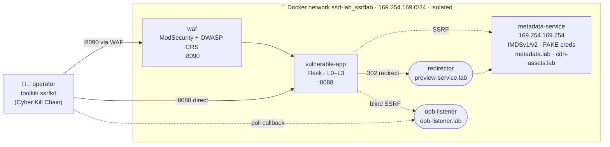

<div align="center">

# 🕳️ SSRF Lab

### A hands-on Server-Side Request Forgery range — attack, defend, and understand

*Flask target with tunable defenses (L0–L3) · mock AWS metadata (IMDSv1/v2) · ModSecurity + OWASP CRS WAF · redirector & out-of-band listener · a custom kill-chain toolkit — wired to real breaches and CVEs*

**Ethical Hacking course project · 100% local, Docker-only · verified end-to-end**

</div>

---

> ## ⚠️ Ethical use only — lab-only
>
> This repository contains **intentionally vulnerable software** and offensive
> tooling, created **solely** for education and authorized security training in
> an **isolated, local laboratory**.
>
> - 🧪 Run it **only** on your own machine, on an isolated Docker network.
> - 🌐 **Never** expose these services to the internet or any production system.
> - 🔑 All credentials in this lab are **fake and invented** — they unlock nothing real.
> - 🎯 Use these techniques **only** against systems you own or have **explicit
>   written permission** to test. Unauthorized access is a crime.
> - 🔬 The real-world analysis in [`docs/research/`](docs/research/README.md) is
>   **research only — no real application was ever attacked.**
>
> Full ethics statement: **[SECURITY.md](SECURITY.md)**.

---

## 🎯 What this is

SSRF (OWASP Top-10) is when an attacker abuses a server into making requests *on
their behalf* — reaching internal systems they could never hit directly. It is
the bug class behind the **2019 Capital One breach**.

This lab studies SSRF from **both sides**, with every claim **verified live**
(see [`docs/TESTVERSLAG.md`](docs/TESTVERSLAG.md)):

- **Offense** — find SSRF (incl. *blind* via out-of-band), bypass string
  filters, parsers, and a WAF, and escalate to a cloud metadata endpoint.
- **Defense** — watch each layer (blocklist → parser → resolve-then-pin → WAF →
  IMDSv2) raise the bar, and see exactly where each one still falls short.

## 🏗️ Architecture



<details><summary>Plain-text diagram</summary>

```
 operator (ssrfkit) ──:8090──▶ WAF (ModSecurity+CRS) ──┐
 operator (ssrfkit) ──:8088──────────────────────────▶ vulnerable-app (L0–L3)
                                     │ SSRF
            ┌────────────────────────┼───────────────────────────┐
            ▼                        ▼                            ▼
   metadata-service        redirector (preview-        oob-listener
   169.254.169.254          service.lab) ─302─▶ meta   (oob-listener.lab)
   IMDSv1/v2, FAKE creds                                blind-SSRF callbacks
   aliases metadata.lab, cdn-assets.lab
```
</details>

## 🛡️ Defense layers — what each really stops (from the live test)

Based on the real results in [`docs/TESTVERSLAG.md`](docs/TESTVERSLAG.md), not on
assumptions:

| Layer | Stops | Bypassed by |
|-------|-------|-------------|
| **L0** — no protection | nothing | everything |
| **L1** — naive string blocklist | the literal `169.254.169.254` | IP **encodings** (decimal/hex/octal), DNS names |
| **L2** — parse host + decode IP ranges | **all** IP encodings | a **DNS name** that resolves inward, a **302 redirect** |
| **L2.5** — check-then-use (TOCTOU) | a statically-internal IP | **DNS rebinding** — validates "safe", re-resolves internal at connect (*demonstrated live*) |
| **L3** — resolve-then-pin + redirect re-validation | encodings, DNS, redirect **and DNS rebinding** | (app-level complete; see residual risks) |
| **WAF** — ModSecurity + OWASP CRS | **all IP-literal** payloads (`403`) | SSRF via a **hostname / redirect** — *the Capital One pattern* |
| **IMDSv2** — token (`PUT`) required | a bare-GET SSRF to credentials (`401`) | not a cure — see residual risks |

**Headline finding:** only **L3** (correct app logic) and **IMDSv2** (platform
hardening) actually stopped the attack. The WAF helped but was walked around with
a benign-looking hostname — exactly what happened at Capital One.

## 🧰 The toolkit — `ssrfkit`, mapped to the Cyber Kill Chain

| Subcommand | Kill-chain stage | Does |
|------------|------------------|------|
| `recon` | Reconnaissance | detect SSRF, incl. **blind** via an OOB callback |
| `weaponize` | Weaponization | craft the bypass payloads |
| `exploit` | Exploitation | fire payloads at the app, with/without the WAF |
| `loot` | Actions on Objectives | exfiltrate the (fake) IAM credentials |
| `audit` | Defensive | check IMDSv1 vs IMDSv2 enforcement |
| `rebind` | — | DNS rebinding: TOCTOU bypass (L2.5) vs L3 |
| `full` | — | the whole chain as a guided demo |

Details: [`toolkit/README.md`](toolkit/README.md).

## 🚀 Quickstart

```
docker compose up -d --build          # start all 5 services
```
- Vulnerable app, **direct**: <http://localhost:8088>
- Vulnerable app, **through the WAF**: <http://localhost:8090>
- Use the **Defense** dropdown to switch L0 → L3 live.

```
python toolkit/ssrf_scan.py           # L0–L3 results matrix
python toolkit/ssrf_scan.py --compare # with vs without the WAF
```
```
# full kill-chain, inside the lab network:
docker run --rm --network ssrf-lab_ssrflab -v "${PWD}/toolkit:/t" python:3.12-slim python /t/ssrfkit.py full
```
```
docker compose down                   # stop & clean up
```

Full step-by-step (and the IMDSv2 flip) is in the
[demo script](demo/DEMOVIDEO_SCRIPT.md) and [test report](docs/TESTVERSLAG.md).

## 🎓 How this addresses the assignment feedback

**(1) "Enough depth — don't stop at 'SSRF succeeded'; look at different defenses
(filters *and* a WAF) and how they're bypassed."**
The lab implements **four** escalating app-side defenses (L0–L3) **plus** a real
**WAF** (ModSecurity + OWASP CRS) **plus** a platform control (**IMDSv2**), and
demonstrates — live — the bypass of each weaker one (encodings, DNS, redirect)
and why only L3 + IMDSv2 hold. See the defense table above and
[`docs/TESTVERSLAG.md`](docs/TESTVERSLAG.md).

**(2) "Test the relevance against real applications (without attacking them)."**
The [reality dossier](docs/research/README.md) maps our lab onto **Capital One**
and real CVEs (**CVE-2024-4084** AnythingLLM, **CVE-2024-29415** node-ip,
**CVE-2024-24759** MindsDB, CrewAI, LLaMA-Factory) — each tied to the exact lab
level it mirrors. **Research only; nothing real was attacked.**

## 📂 Repository layout

```
.
├── vulnerable-app/     # Flask target, defense levels L0–L3
├── metadata-service/   # mock AWS metadata, IMDSv1/v2, FAKE IAM creds
├── waf/                # ModSecurity + OWASP CRS (reverse proxy)
├── redirector/         # lab "attacker redirect" host (L2 bypass)
├── oob-listener/       # out-of-band callback collector (blind SSRF)
├── dns-rebind/         # deterministic rebinding DNS (TOCTOU demo)
├── toolkit/            # ssrfkit CLI + ssrf_payloads / ssrf_scan / imds_check
├── docs/
│   ├── TESTVERSLAG.md  # live end-to-end test report (evidence)
│   └── research/       # reality dossier: Capital One + real CVEs
├── demo/               # demo video script
├── docker-compose.yml  # the whole lab, one command
├── LOGBOEK.md          # learning logbook (Dutch)
├── SECURITY.md · LICENSE
```

## 🔑 Credentials & addresses (all fake, lab-only)

| Item | Value |
|------|-------|
| App (direct / via WAF) | `http://localhost:8088` / `http://localhost:8090` |
| Metadata (internal) | `169.254.169.254` — aliases `metadata.lab`, `cdn-assets.lab` |
| Redirector / OOB (internal) | `preview-service.lab` / `oob-listener.lab` |
| IAM role | `lab-ec2-demo-role` |
| AccessKeyId | `ASIAZ4LAB5EXAMPLE999` |
| SecretAccessKey | `wJalrXUtnFEMI/K7MDENG/bPxRfiCYEXAMPLEKEY` |

> These are invented (they match AWS's public *example* values) and authenticate
> to nothing. Real-valued secrets would live in git-ignored `*.local.md` / `.env`.

## ⚖️ Residual risks (honest limits)

- **L3 pinning** is implemented for HTTP; HTTPS needs an SNI-preserving pinning
  adapter. A sophisticated TTL=0 DNS-rebinding race remains theoretically hard.
- A **WAF** is pattern-based — good at obvious payloads, blind to benign-looking
  hostnames/redirects.
- **IMDSv2** is not a cure: it doesn't help if the app hands the attacker a full
  HTTP client (PUT + headers), nor against already-leaked v1 credentials.
- Takeaway: **defense-in-depth** — layers covering each other's blind spots.

## 🗂️ Running inside OneDrive

This repo lives in a OneDrive folder. **Pause OneDrive sync** during heavy git /
Docker work, and **push often** (the remote is your real backup). Docker uses
named volumes, so no heavy runtime data is synced.

---

<div align="center">
<sub>Built for learning. Hack what you own. 🛡️ · See <a href="docs/TESTVERSLAG.md">TESTVERSLAG</a> · <a href="LOGBOEK.md">LOGBOEK</a> · <a href="docs/research/README.md">reality dossier</a></sub>
</div>
