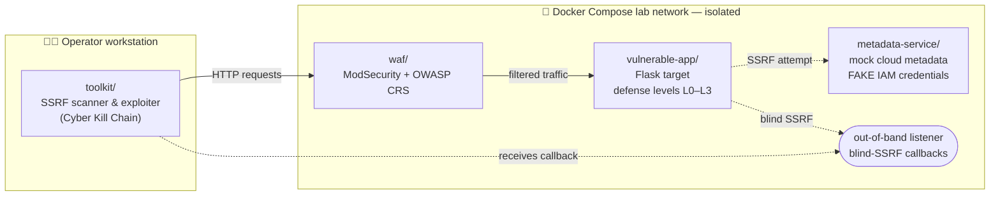

<div align="center">

# 🕳️ SSRF Lab

### A hands-on Server-Side Request Forgery range — attack, defend, and understand

*Flask target with tunable defenses · mock cloud metadata · ModSecurity WAF · a custom SSRF toolkit · mapped to the Cyber Kill Chain and real-world breaches*

**Ethical Hacking course project · built entirely in Docker · 100% local**

</div>

---

> ## ⚠️ Ethical use only — lab-only
>
> This repository contains **intentionally vulnerable software** and offensive
> tooling, created **solely** for education and authorized security training in
> an **isolated, local laboratory**.
>
> - 🧪 Run it **only** on your own machine, on an isolated Docker network.
> - 🌐 **Never** expose these services to the internet or any production system.
> - 🔑 All credentials in this lab are **fake and invented** — they unlock nothing real.
> - 🎯 Use the techniques shown here **only** against systems you own or have
>   **explicit written permission** to test. Unauthorized access is a crime.
>
> Full ethics statement: **[SECURITY.md](SECURITY.md)**.

---

## 🎯 Goal

Server-Side Request Forgery (SSRF) is an OWASP Top-10 class of vulnerability in
which an attacker abuses a server into making requests *on their behalf* — often
to internal systems the attacker could never reach directly. It is the exact bug
class behind the **2019 Capital One breach**.

This project builds a complete, self-contained lab to understand SSRF from **both
sides**:

- **Offense** — how SSRF is found (including *blind* SSRF), how filters and a WAF
  are bypassed, and how it is escalated to read a cloud metadata endpoint.
- **Defense** — how layered defenses (input validation, allowlisting, network
  segmentation, a WAF) each raise the bar, and where each one still falls short.

Everything is wired to real-world context: the Capital One breach and recent CVEs.

## 🏗️ Planned architecture



<details>
<summary>Plain-text diagram (if Mermaid doesn't render)</summary>

```
  Operator workstation                 Docker Compose lab network (isolated)
 ┌─────────────────────┐        ┌─────────────────────────────────────────────┐
 │  toolkit/           │  HTTP  │   waf/            vulnerable-app/             │
 │  SSRF scanner &     │ ─────▶ │  ModSecurity  ─▶  Flask target (L0–L3)        │
 │  exploiter          │        │  + OWASP CRS         │                        │
 │  (Cyber Kill Chain) │        │                      │ SSRF attempt           │
 │                     │        │                      ▼                        │
 │                     │        │              metadata-service/                │
 │                     │        │              mock metadata (FAKE creds)       │
 │                     │        │                      ▲                        │
 │                     │        │   out-of-band listener (blind-SSRF callbacks) │
 │                     │◀┄┄┄┄┄┄┄│┄┄┄┄┄┄┄┄┄┄┄┄┄┄┄┄┄┄┄┄┄┘                        │
 └─────────────────────┘        └─────────────────────────────────────────────┘
```
</details>

## 🧭 Roadmap — 7 phases

| Phase | Focus | Component | Status |
|:-----:|-------|-----------|:------:|
| **0** | Project scaffolding, ethics & tooling hygiene | *this skeleton* | ✅ done |
| **1** | Vulnerable Flask app with defense levels **L0–L3** | `vulnerable-app/` | ⬜ planned |
| **2** | Mock cloud metadata service with **fake** IAM credentials | `metadata-service/` | ⬜ planned |
| **3** | WAF layer: **ModSecurity + OWASP CRS** | `waf/` | ⬜ planned |
| **4** | SSRF **toolkit**: detection (incl. blind/OOB), bypasses, metadata read — on the Cyber Kill Chain | `toolkit/` | ⬜ planned |
| **5** | **Research dossier**: Capital One, recent CVEs, defenses | `docs/` | ⬜ planned |
| **6** | **Demo** video + final report / presentation | `demo/` | ⬜ planned |

## 📂 Repository layout

```
.
├── vulnerable-app/     # Phase 1 · Flask target (L0–L3)
├── metadata-service/   # Phase 2 · mock metadata, fake IAM creds
├── waf/                # Phase 3 · ModSecurity + OWASP CRS
├── toolkit/            # Phase 4 · our SSRF detection/exploitation tool
├── docs/               # Phase 5 · research dossier + diagrams
│   ├── diagrams/
│   └── research/
├── demo/               # Phase 6 · demo video script & assets
├── README.md           # you are here
├── LOGBOEK.md          # learning logbook (Dutch)
├── SECURITY.md         # ethics / lab-only policy
├── LICENSE             # educational-use-only license
├── requirements.txt    # Python dependencies (per phase)
├── .gitignore          # secrets / Docker / Python / OS junk
├── .gitattributes      # force LF so files work inside Linux containers
└── .editorconfig       # consistent formatting
```

## 🔒 How this lab stays safe

- **Isolated by design** — all services run on a private Docker Compose network;
  nothing is published to the public internet.
- **Fake everything** — the "cloud credentials" are invented strings; they grant
  no access to any real system.
- **Named Docker volumes** — runtime data lives in Docker-managed volumes, *not*
  bind-mounted into this (OneDrive-synced) folder.
- **Secrets never committed** — `.gitignore` blocks `.env` and `*.local.md`; we
  commit `*.example` templates only.

## 🗂️ Running in OneDrive — read this once

This repo lives inside a OneDrive folder. OneDrive can fight with `.git` and with
Docker data. Two habits keep it healthy:

1. **Pause OneDrive sync** while doing heavy git or Docker work (OneDrive tray icon
   → *Pause syncing*). Resume afterwards.
2. **Push often** to your remote — it is your real backup if OneDrive ever mangles
   a local file.

## 🔑 Credentials ledger

Fake credentials created by the lab are tracked here as they are introduced, and
also shown copy-ready in the working session.

| Phase | Service | Username / Key | Secret / Password | Notes |
|:-----:|---------|----------------|-------------------|-------|
| 0 | — | — | — | No credentials created yet. |

> Real-valued secret files (e.g. `*.local.md`, `.env`) are **git-ignored** and
> never leave your machine.

---

<div align="center">
<sub>Built for learning. Hack what you own. 🛡️</sub>
</div>
